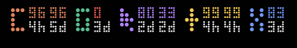

# AI Usage — macOS 메뉴 막대 AI 구독 사용량 모니터

Claude · ChatGPT(Codex) · Cursor · Gemini · Grok 구독의 **남은 사용량과 리셋까지 남은 시간**을 macOS 메뉴 막대에 도트(pixel dot) 디자인으로 보여주는 앱입니다.

> 🪟 Windows 작업표시줄 버전: [drivethatbear-beep/ai-usage-bar](https://github.com/drivethatbear-beep/ai-usage-bar)



```
C  96  96    G  0     ▶  80  33    ✦  99  99    X  83
   4h  5d       3d       2d  2d       4h  4h       3d
```

- **큰 글자 색** = 서비스 · **위 줄** = 남은 % · **아래 줄** = 리셋까지 남은 시간(`45m` / `4h` / `5d`)
- 남은 양이 10% 미만이면 숫자가 빨간색으로 바뀝니다.
- 아이콘을 클릭하면 사용 기간별 도트 막대, 리셋 시각, 크레딧 잔액이 담긴 카드가 열립니다.

| 표시 | 서비스 | 보여주는 값 | 데이터 출처(로컬 로그인 정보) |
|---|---|---|---|
| 🟧 `C` | Claude | 5시간 창 · 7일 창(+ 모델별 주간) | Claude Code CLI 키체인 토큰 |
| 🟩 `G` | ChatGPT · Codex | 주간(·5시간) 창, 크레딧 잔액 | `~/.codex/auth.json` |
| 🟪 `▶` | Cursor | 월간 전체 · 월간 API | Cursor 앱 로컬 설정 DB |
| 🟨 `✦` | Gemini | Pro · Flash(+ Antigravity 내 Claude) | Antigravity 로그인 토큰 |
| 🟦 `X` | Grok | 주간 구독 사용률 | 앱 안의 grok.com 로그인 |

## 설치

### 다운로드
1. [Releases](../../releases)에서 `AI-Usage-macOS.zip`을 받아 압축을 풉니다(Apple Silicon·Intel 공용, macOS 13 이상).
2. `AI Usage.app`을 `응용 프로그램` 폴더로 옮깁니다.
3. Apple 공증을 받지 않은 앱이라 처음 실행이 막히면 터미널에서 아래 명령을 한 번 실행합니다.
   ```bash
   xattr -dr com.apple.quarantine "/Applications/AI Usage.app"
   ```

### 소스에서 빌드
Xcode(또는 Swift 5.9 이상 툴체인)가 필요합니다.
```bash
git clone https://github.com/drivethatbear-beep/ai-usage-bar-mac.git
cd ai-usage-bar-mac
./build.sh            # 빌드 후 ~/Applications 에 설치하고 실행
./build.sh --package  # 배포용 Universal zip(dist/AI-Usage-macOS.zip) 생성
```

## 서비스별 준비
- **Claude**: 터미널에서 `claude auth login`으로 Claude Code CLI에 로그인합니다(메뉴의 "Claude CLI 로그인…").
- **ChatGPT/Codex**: Codex 앱 또는 `codex login`으로 로그인합니다.
- **Cursor**: Cursor 앱에 로그인돼 있으면 됩니다.
- **Gemini**: Antigravity 앱에 로그인돼 있으면 됩니다. Antigravity가 갱신해 둔 토큰을 읽습니다.
  만료된 토큰을 이 앱이 직접 갱신하게 하려면 OAuth 클라이언트 값을 설정합니다(선택).
  ```bash
  defaults write io.github.drivethatbear-beep.ai-usage-bar geminiClientID "<client id>"
  defaults write io.github.drivethatbear-beep.ai-usage-bar geminiClientSecret "<client secret>"
  ```
- **Grok**: 메뉴의 "Grok 로그인…"에서 grok.com에 한 번 로그인합니다. 자동으로 읽을 수 없을 때를 위한 수동 리셋 타이머도 있습니다.

메뉴 막대가 꽉 차면 macOS가 새 아이콘을 `«` 안으로 숨깁니다. 한 번만 ⌘(Command)를 누른 채 아이콘을 시계 쪽으로 끌어다 놓으면 그 위치가 유지됩니다.

## 보안 · 개인정보
- 로그인 정보는 **읽기만** 하며 다시 저장하지 않습니다. 갱신한 토큰은 메모리에만 둡니다(CLI·앱 로그인이 깨지지 않음).
- 토큰은 각 서비스의 공식 주소(api.anthropic.com, chatgpt.com, cursor.com, cloudcode-pa.googleapis.com, grok.com)로만 HTTPS로 전송합니다.
- 네트워크 캐시와 쿠키 저장소를 쓰지 않아 토큰이 디스크에 남지 않습니다.
- Grok 로그인 창은 허용된 로그인 도메인만 열고, 창 제목에 현재 도메인과 🔒 표시가 나옵니다.
- 분석·텔레메트리 기능은 없으며, 외부 서버로 사용량 데이터를 보내지 않습니다.

## 주의
- 각 서비스의 **비공식(문서화되지 않은) 엔드포인트**를 사용합니다. 서비스 쪽 변경으로 언제든 동작이 멈출 수 있고, 각 서비스 약관은 사용자가 직접 확인해야 합니다.
- 이 프로젝트는 Anthropic, OpenAI, Anysphere(Cursor), Google, xAI와 관련이 없습니다.

## 라이선스
[MIT](LICENSE)

---

### English
**AI Usage** is a macOS menu bar app that shows the remaining quota and time-to-reset for Claude, ChatGPT (Codex), Cursor, Gemini and Grok subscriptions in a pixel-dot style. It reads the local sign-in state of each official client (read-only; refreshed tokens stay in memory), never writes credentials to disk, and sends tokens only to each provider's own endpoints over HTTPS. It relies on undocumented endpoints that may change at any time. Build with `./build.sh`, or download the universal zip from Releases. MIT licensed. Windows version: [ai-usage-bar](https://github.com/drivethatbear-beep/ai-usage-bar).
